<h1 align="center">TowardsLight Blog Extension</h1>

<p align="center"><a href="./README.md">简体中文</a> · <a href="./README.en.md">English</a></p>

<p align="center"><a href="https://towardslight.vercel.app/">Demo Site</a> · <a href="https://towardslightcontent.vercel.app/">Personal Site</a></p>

A local writing and management extension built specifically for the TowardsLight blog repository. It brings posts, site configuration, categories, links, preview, and Git commits into VS Code, so the full writing loop can stay inside one workspace.

> This is a purpose-built extension, not a generic Markdown manager. It understands this blog's `site.ts / links.ts / posts/ / images/` layout and the binding between the Astro template and a content profile.

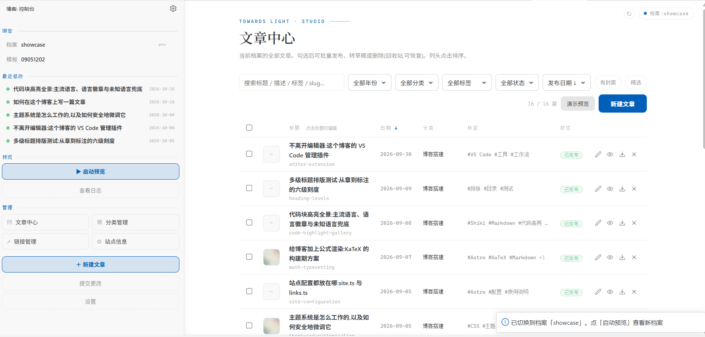

## Workflow

The blog's content is already file-based: posts are Markdown, site configuration lives in `site.ts`, and the link directory lives in `links.ts`. Editing those files by hand is not hard; the friction comes from repeatedly opening a terminal, locating files, scanning fields, and switching to a browser. This extension keeps that loop in the editor:

1. Confirm the current profile and template in the sidebar.
2. Find, create, or manage posts in Posts Center.
3. Write Markdown in the editor and insert body images with the right-click command.
4. Fill metadata or generate a description from the current-post property panel.
5. Start a local preview and inspect the page in VS Code or a browser.
6. Select files in the commit panel, generate or write a commit message, and decide whether to push.

## Installation and requirements

The extension is not published to the marketplace yet. Install the local VSIX:

```bash
code --install-extension .\towards-light-editor-0.18.1.vsix --force
```

Run **Developer: Reload Window** after installation. Open the blog repository root when using it. The template directory must contain `package.json` and `scripts/use-profile.mjs`. A content profile needs at least `site.ts`, `links.ts`, and `posts/`; when those are missing, the extension can initialize the directory as a new profile.

## Sidebar console

The sidebar is a custom WebviewView rather than a native VS Code tree. It has two modes:

- **Console mode** shows the active profile, active template, recently modified posts, preview servers, and management entries.
- **Current-post mode** appears when a Markdown post inside the active profile is opened, exposing that post's metadata directly.

The current-post panel supports title, description, category, tags, publish date, cover, cover description, crop position, draft, and featured. Saving rewrites only that post's frontmatter, leaves the body untouched, and updates `updatedDate`.

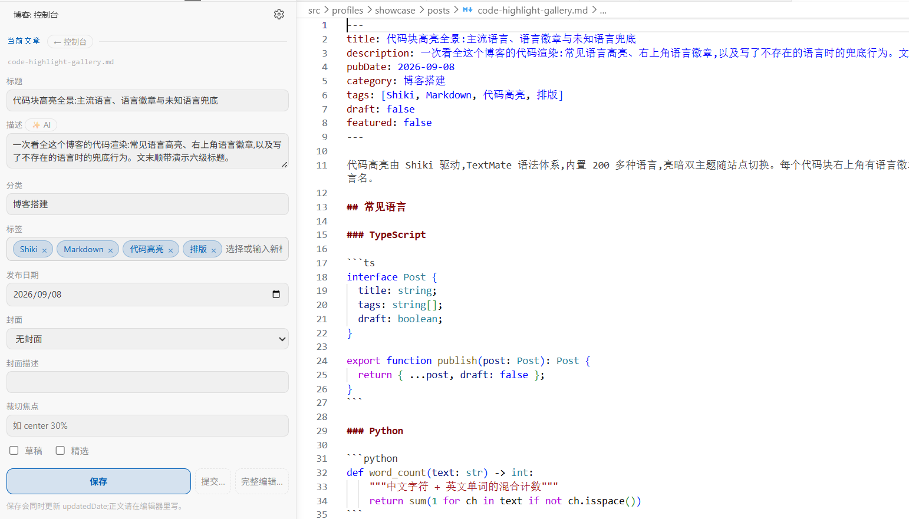

## Profiles and templates

A profile is a complete content bundle: `site.ts / links.ts / posts/ / images/`. A template is the Astro project that renders that content. Profiles are resolved in this order:

1. `SITE_PROFILE_DIR`
2. `personal/` under the workspace root
3. The built-in `src/profiles/showcase/`

You can also switch profiles from the sidebar. The extension scans two directory levels below the workspace root for valid profiles, and a custom directory can be selected manually. The selection is stored in `workspaceState` and survives window reloads. A custom directory missing `site.ts / links.ts / posts/` can be initialized as a new profile.

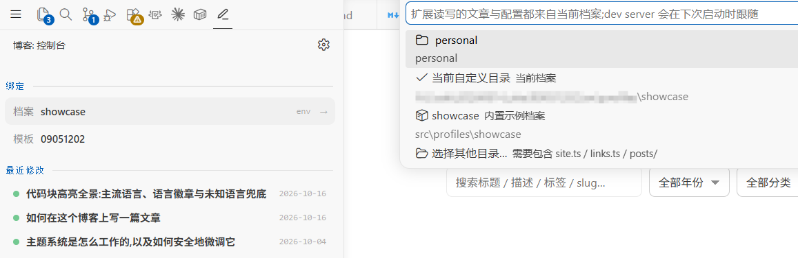

Every form locks onto the profile that was active when it opened, and the badge in the upper-right corner identifies the target. If the binding changes after the form opens, submission is rejected and the form asks to be reopened, preventing writes to the wrong profile.

## Posts Center

Posts Center manages every post in the active profile as a list:

- Shows cover thumbnails, titles, slugs, publish dates, categories, tags, and status.
- Searches title, description, tags, and slug; multiple keywords must all match.
- Filters by year, category, tag, or status, and can show only posts with covers or featured posts.
- Column headers and the sort control both change ordering; clicking a title opens the Markdown body, while row actions open metadata editing or preview.
- Supports row-level publish/draft toggles and deletion to the system recycle bin.
- Supports batch publish, batch draft conversion, and batch deletion after selecting multiple posts.
- "Demo Preview" starts the homepage preview for the active profile.
- Here, "published" only means `draft: false`, allowing the post to be included in site builds. It is unrelated to Git commit or push.

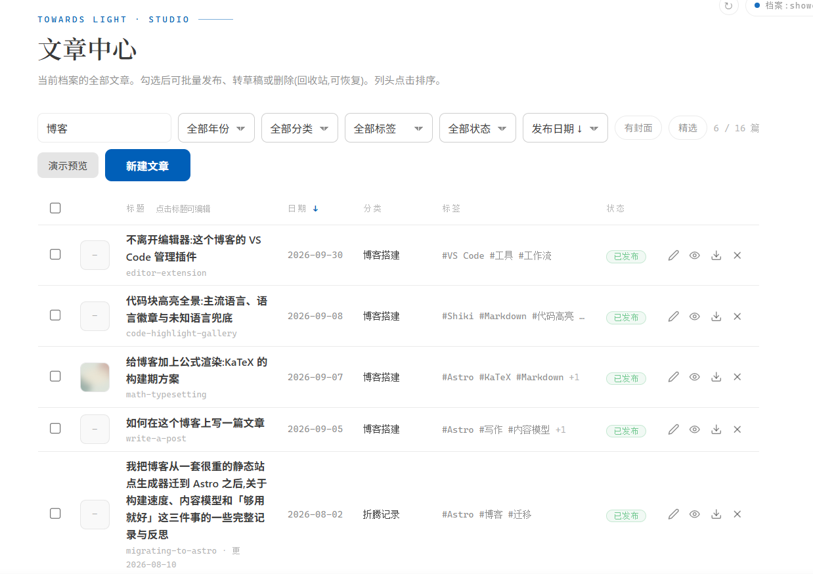

### Creating and editing posts

The new-post form creates a Markdown file under the active profile's `posts/` directory. A slug can be derived from the title; categories and tags can be selected from existing values or entered as new names. A cover can be selected from the existing image library or copied from the local machine into the post image directory.

When editing an existing post, the form rewrites only frontmatter and leaves the body and image files untouched. The slug is locked. Descriptions can be generated with AI, but the result remains a draft until explicitly saved.

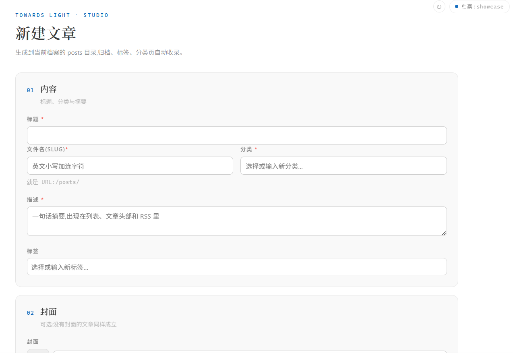

## Inline images

Use the right-click command **Insert Body Image** inside a Markdown editor. The extension will:

1. Open the system image picker, with multi-select supported.
2. Copy the selected images into `posts/image/<post-name>/` for the current post.
3. Append `-2`, `-3`, and so on when names collide, instead of overwriting old images.
4. Insert `` at the cursor.

Images are copied, not moved; the source files stay where they were.

## Preview

Preview starts the Astro dev server in the template directory and injects the active profile through `SITE_PROFILE_DIR`:

- The same template/profile pair reuses its server; occupied ports advance automatically.
- The preview can open in a VS Code panel through an iframe or in a browser.
- Dev-server stdout and stderr stream into the "TowardsLight Preview" output channel; startup failures reveal the log.
- Servers started by the extension are tracked by PID, and orphaned processes whose host is gone are reclaimed on restart.
- Switching profiles actively stops the old profile's preview instead of auto-restarting, preventing `src/profiles/active` and `public/images` junctions from conflicting.
- The extension watches the actual junction targets, repairs missing links against the active profile, and records external changes in the log.

## Commit changes

The **Commit Changes** panel detects the Git repositories that contain the active profile, workspace root, and template directory, with manual switching between candidates. By default it lists every changed file in the selected repository:

- Files are checked individually; unchecked files are not committed.
- "Push after commit" is off by default and must be selected explicitly.
- The profile guard rejects submission if the profile binding changed after the panel opened.
- Untracked text files are included in the AI context so the model sees more than just file names.

When opened from the current-post property panel, the panel preselects the current post and the image directories actually referenced by its body or cover. The conventional `posts/image/<post-name>/` directory remains a fallback, but the image directory no longer has to match the post filename exactly.

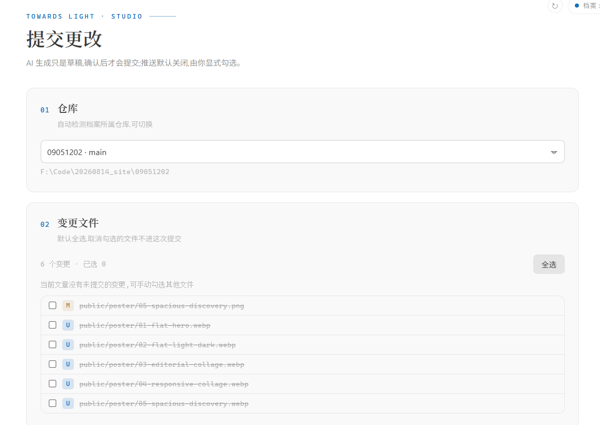

AI-generated commit messages only see the selected files. Recent repository commits are used as style examples, not as a source for old project names or topics. Generated text is written into the input field for review and is never committed automatically.

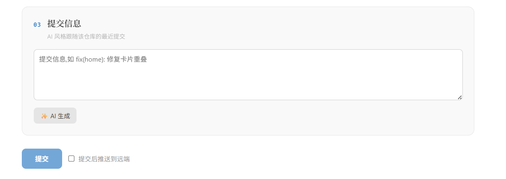

## Site settings

Site settings write back to the active profile's `site.ts`: site name, author, long and short signatures, email, site URL, default theme, avatar, current status, homepage hero, navigation action buttons, page backgrounds, and title/description for archive, tags, categories, links, and 404 pages.

- Navigation action buttons support name, URL, icon, and ordering, and are written to `socialLinks` in `site.ts`; RSS is hidden on desktop and remains available on mobile and in the footer.
- Image fields show live thumbnails.
- **Choose Image** copies the selected image into the profile's `images/` directory and references it as `/images/...`.
- Writes are AST-level, in-place edits, preserving comments, formatting, and `as const` assertions.
- Unsaved input is restored when the panel is rebuilt; if the file changes elsewhere, the stale draft is discarded and the file wins.

<table>
  <tr>
    <td width="58%">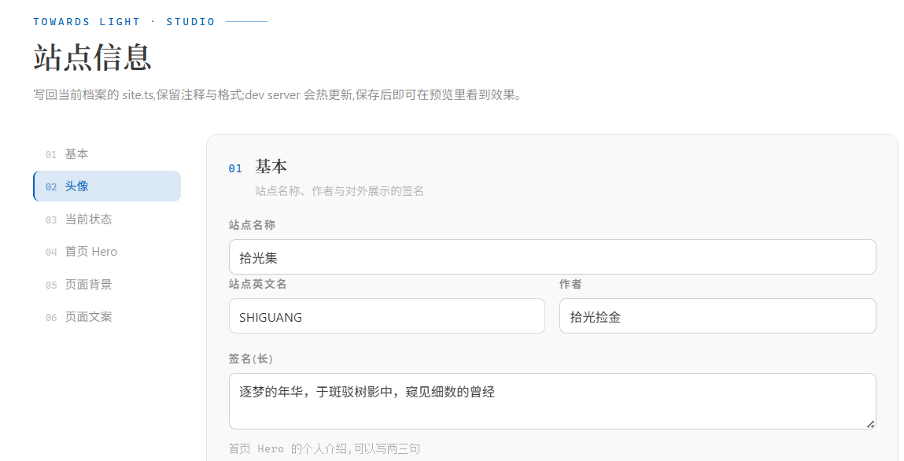</td>
    <td width="42%">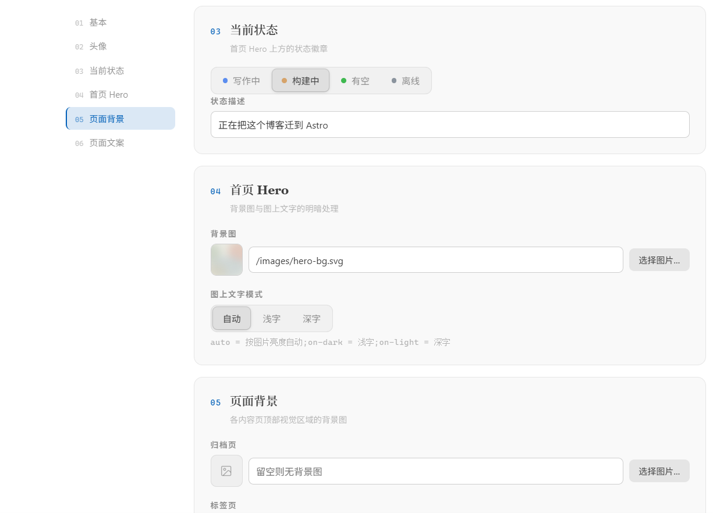</td>
  </tr>
</table>

## Category management

Categories are written to `categoryMeta` in `site.ts`; a post belongs to a category when its frontmatter uses the same `category` value.

- Supports creating categories and editing icon, tone, and description.
- The category list shows how many posts reference each category.
- Referenced categories cannot be renamed or deleted; unreferenced categories can be renamed or removed.
- Categories used by posts but missing from `categoryMeta` are listed as well and can be registered in one step.

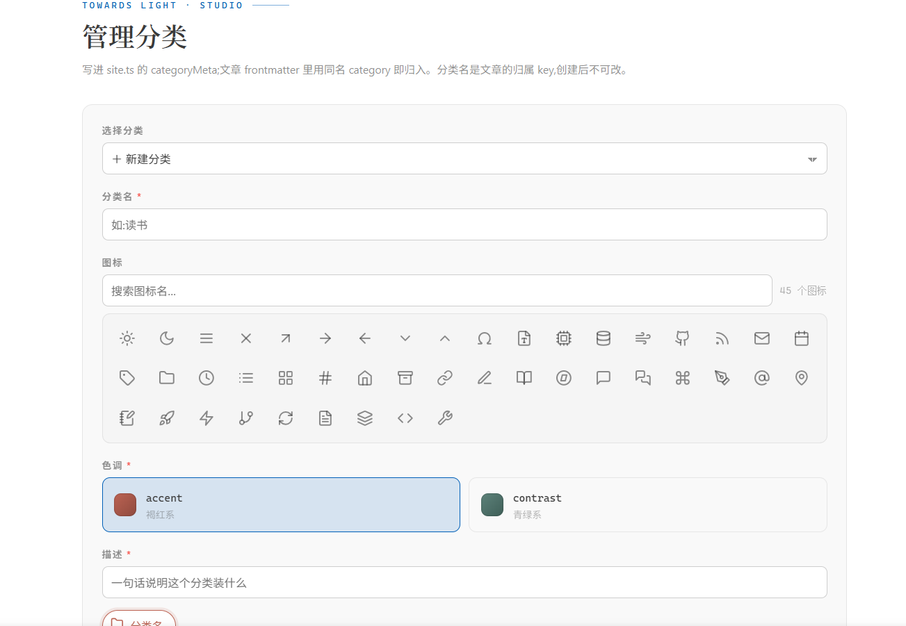

## Link management

Link management writes to the active profile's `links.ts`. The page is organized by groups and supports:

- Creating groups, editing names/descriptions, and deleting empty groups.
- Dragging group headers to reorder groups.
- Inline link editing and moving links up or down within a group.
- Two-step deletion to avoid accidental clicks.
- Icon search, `featured` card display, and `home` homepage placement.
- At most three homepage links; additional selections are rejected by the form.

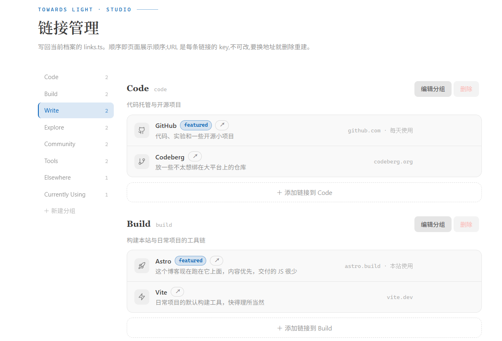

## Icon import

Enter an icon name from lucide.dev, and the extension extracts its SVG from `lucide-static` and appends it to the template's `Icon.astro`. Reopen the category or link form to select the new icon.

## AI and settings

The settings panel currently contains two groups:

- **AI Summary** uses the VS Code language model by default, reusing the Copilot sign-in without extra configuration. It can also switch to a custom OpenAI-compatible endpoint. `Base URL` and `model` are stored in extension workspace state; the `API key` is stored separately in VS Code `SecretStorage` and is never written to a configuration file. If the model is unavailable or a request fails, the extension falls back to local extraction.
- **Preview** configures the starting port for the Astro dev server; occupied ports advance automatically. When Node.js is left blank, the extension resolves a template-compatible runtime from fnm or PATH, and a specific `node.exe` can be set manually.

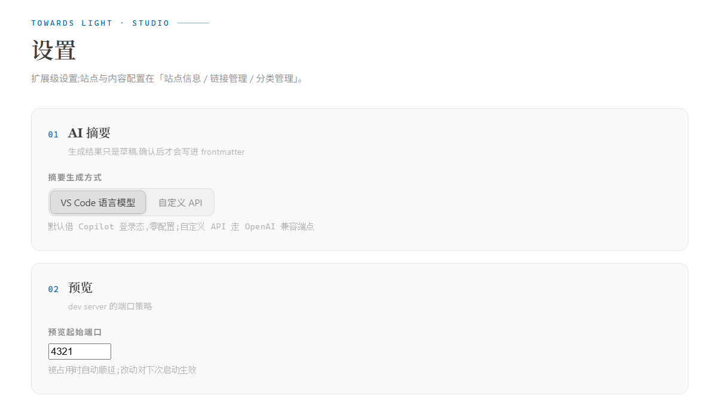

The same AI configuration is used for post descriptions and commit messages. Both kinds of generated content are shown as drafts first and are never written or committed automatically.

## Image asset conventions

```text
<profile>/
├── images/                  # Site-level: avatar, hero, and page backgrounds; referenced as /images/...
└── posts/
    ├── my-post.md
    └── image/my-post/       # Post-level: covers and body images; referenced by relative paths
```

Article-scoped commits read the image references in the post body, which keeps older posts working even when their images live under a shortened directory name. Newly inserted images still use `image/<post-name>/`.

## Development

```bash
npm install
npm run build      # esbuild outputs: dist/extension.js + dist/core.mjs
npm test           # 37 core assertions + 3 Git-context assertions
npm run package    # Build the VSIX
```

For debugging, open the `editor/` directory in VS Code and press `F5`. The Extension Development Host loads the extension and opens the blog repository root.

Source layout:

```text
src/extension.ts        # Command registration, profile switching, image insertion, lifecycle
src/sidebar.ts          # Sidebar console and current-post property panel
src/preview.ts          # Dev-server ledger, iframe preview, and junction awareness
src/git.ts              # Repository discovery, status, diff, selective commit, and push
src/ai.ts               # AI provider selection, Copilot/OpenAI/local fallback
src/core/               # VS Code-independent file I/O, AST edits, frontmatter, and image logic
src/webviews/           # Posts Center, post editor, commit panel, site/category/link/settings panels
templates/profile/      # New-profile scaffold
```

## Boundaries

- This extension manages local files and local Git history; it does not deploy the site.
- It does not rename post slugs or schedule posts.
- AI only drafts descriptions and commit messages; file writes and commits always require confirmation.
- Oversized untracked text files are excluded from AI context; binary files participate only as paths.