<h1 align="center">TowardsLight 博客插件</h1>

<p align="center"><a href="./README.md">简体中文</a> · <a href="./README.en.md">English</a></p>

面向这个博客仓库的本地写作与管理扩展。它把文章、站点配置、分类、链接、预览和 Git 提交收进 VS Code：新建文章、写正文、插图、改元数据、预览页面、勾选提交，都可以在一个工作区里完成。

> 这是为 TowardsLight 定制的插件，不是通用 Markdown 管理器。它理解这个博客的 `site.ts / links.ts / posts/ / images/` 结构，以及模板与内容档案的绑定机制。

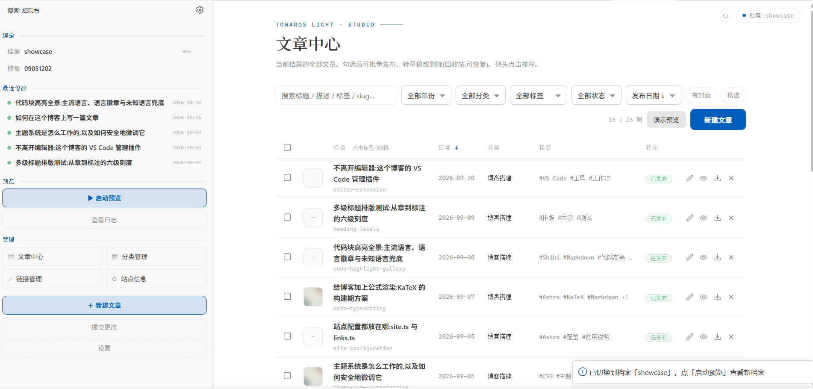

## 适合什么流程

这个博客的内容本身就在文件里：文章是 Markdown，站点配置是 `site.ts`，链接目录是 `links.ts`。手写这些文件不难，真正打断写作的是反复开终端、找文件、翻字段、切浏览器。插件把这条动线收进编辑器：

1. 在侧边栏确认当前档案与模板。
2. 从文章中心查找、新建或管理文章。
3. 在编辑器中写 Markdown，用右键命令插入正文图片。
4. 在当前文章属性面板中补元数据、生成摘要。
5. 启动本地预览，在 VS Code 面板或浏览器里看页面。
6. 在提交面板中勾选文件、生成或手写提交信息，再决定是否推送。

## 安装与要求

暂不上架扩展市场，本地安装 VSIX：

```bash
code --install-extension .\towards-light-editor-0.17.5.vsix --force
```

安装后执行一次 **Developer: Reload Window**。使用时请打开博客工程根目录；模板目录需要包含 `package.json` 和 `scripts/use-profile.mjs`。档案目录至少需要包含 `site.ts`、`links.ts` 和 `posts/`，缺失时插件会报错并给出修复入口。

## 侧边栏控制台

侧边栏不是 VS Code 原生树，而是自绘 WebviewView。它承担两个模式：

- **控制台模式**：显示当前档案、当前模板、最近修改文章、预览 server 与管理入口。
- **文章属性模式**：打开档案内任意一篇 Markdown 后自动切换，直接编辑这篇文章的元数据。

当前文章属性面板支持标题、描述、分类、标签、发布日期、封面、封面描述、裁切焦点、草稿与精选。保存时只改写对应文章的 frontmatter，正文保持不动，并同步更新 `updatedDate`。

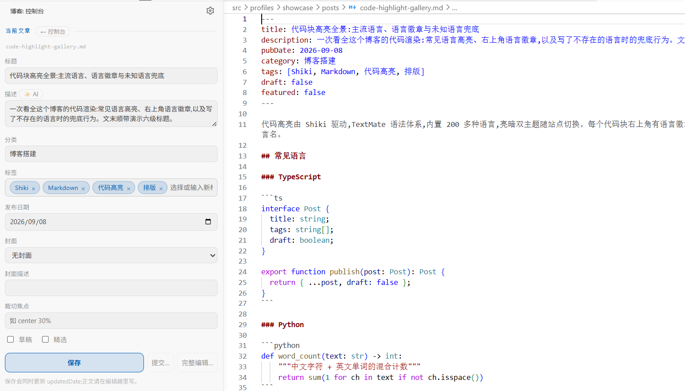

## 档案与模板

档案是一组完整内容数据：`site.ts / links.ts / posts/ / images/`。模板是渲染这些数据的 Astro 工程。插件按以下顺序解析档案：

1. `SITE_PROFILE_DIR`
2. 工作区根目录下的 `personal/`
3. 内置 `src/profiles/showcase/`

也可以在侧边栏点「档案」手动切换。插件会扫描工作区根目录往下两层，找出有效档案；也可以选择一个自定义目录。选择会写入 `workspaceState`，重载窗口后仍生效。缺 `site.ts / links.ts / posts/` 的自定义目录可以初始化成新档案。

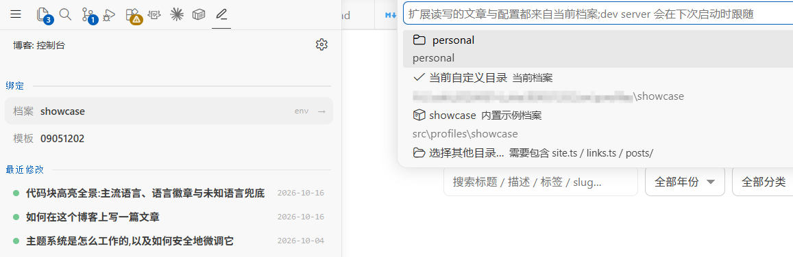

所有表单在打开时锁定当时档案，右上角徽章标明作用目标。打开表单后再切换档案，提交会被拒绝并提示重开；这样可以避免把内容写错档案。

## 文章中心

文章中心用列表管理当前档案的全部文章：

- 显示封面缩略图、标题、slug、发布日期、分类、标签、状态。
- 支持按标题、描述、标签、slug 搜索，多个关键词是「同时命中」。
- 支持按年份、分类、标签、状态筛选，也可以只看「有封面」或「精选」。
- 列头和排序控件都可排序；点击标题打开正文，图标进入元数据编辑或预览。
- 支持行内发布/转草稿、删除到系统回收站。
- 勾选多篇后，可批量设为发布、批量转草稿或批量删除。
- 「演示预览」会启动当前档案的首页预览。
- 这里的「发布」只是 `draft: false`，表示允许进入站点构建；与 Git commit / push 无关。

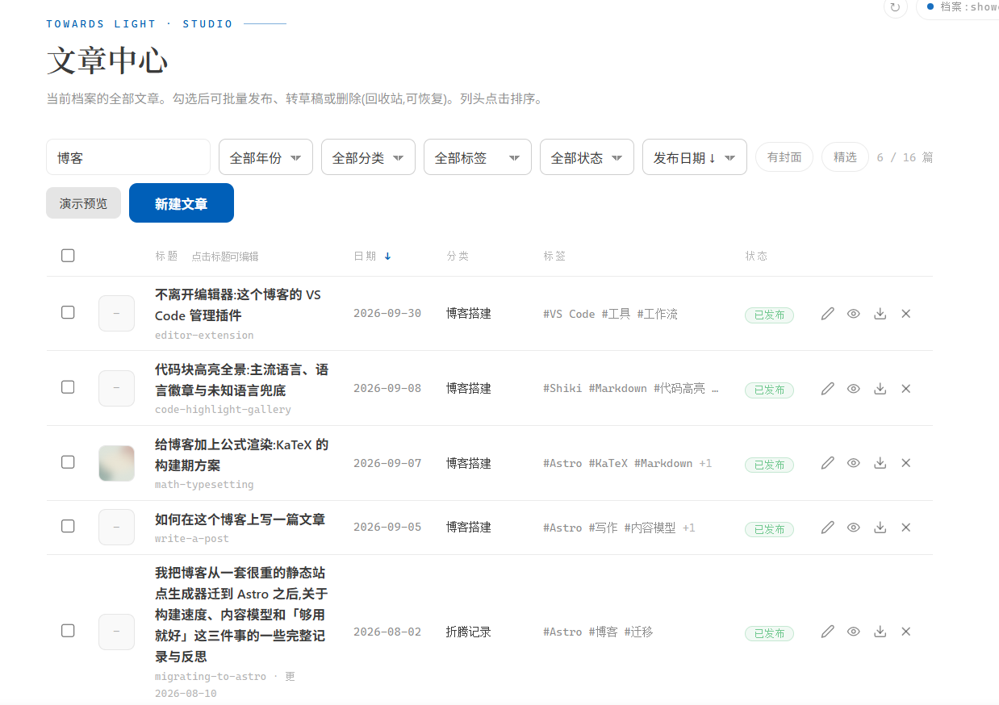

### 新建与编辑文章

新建表单生成当前档案 `posts/` 下的 Markdown 文件。标题可派生 slug，分类与标签支持从已有值中选择，也允许输入新名称。封面可从现有图库选择，也可从电脑复制到文章图片目录。

编辑已有文章时，表单只改写 frontmatter，不碰正文与图片文件；`slug` 锁定不改。描述可以通过 AI 生成，但生成结果只是草稿，确认后才落盘。

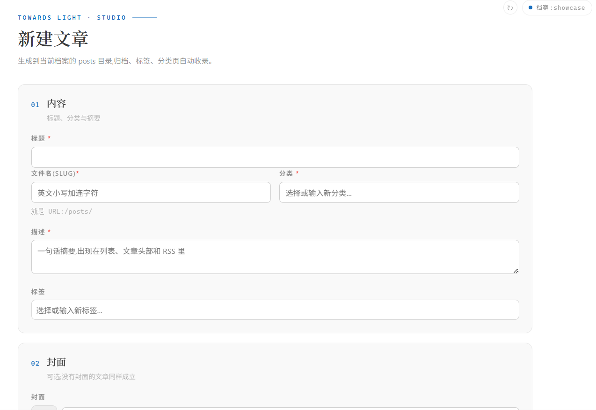

## 正文插图

在 Markdown 编辑器里使用右键命令「插入正文图片」。插件会：

1. 打开系统图片选择器，支持多选。
2. 把图片复制到当前文章的 `posts/image/<文章名>/` 目录。
3. 撞名时自动追加 `-2`、`-3`，不覆盖旧图。
4. 在光标处插入 ``。

复制不是移动，源文件不会被删除。

## 预览

预览在模板目录启动 Astro dev server，并通过 `SITE_PROFILE_DIR` 注入当前档案：

- 同一组「模板 + 档案」复用 server；端口被占用时自动顺延。
- 可在 VS Code 面板中以 iframe 打开，也可在浏览器打开。
- dev server 的 stdout/stderr 汇入「TowardsLight 预览」输出频道；启动失败会亮出日志。
- 插件按 PID 账本回收自己启动的 server；重启或 Reload Window 时会清理确认已经失主的孤儿进程。
- 切换档案时主动停止旧档案预览，不自动重启，避免 `src/profiles/active` 与 `public/images` 的 junction 互相覆盖。
- 插件会持续观察 junction 的实际指向；缺失时按当前档案补齐，被外部进程改变时写入日志并提醒。

## 提交更改

「提交更改」面板会检测当前档案、工作区根和模板目录所属的 Git 仓库，可手动切换。默认列出该仓库的全部变更：

- 文件支持逐条勾选；没有勾选的文件不会进入本次提交。
- 「提交后推送到远端」默认关闭，需要显式勾选。
- 提交前会做档案守卫；面板打开后切过档案会拒绝提交。
- 未跟踪的文本文件会补入 AI 上下文，避免模型只看到文件名。

从当前文章属性面板点「提交…」时，会预选当前文章和它正文、封面实际引用的图片目录；标准目录 `posts/image/<文章名>/` 仍会保留为兜底，但不再假设图片目录一定等于文章文件名。

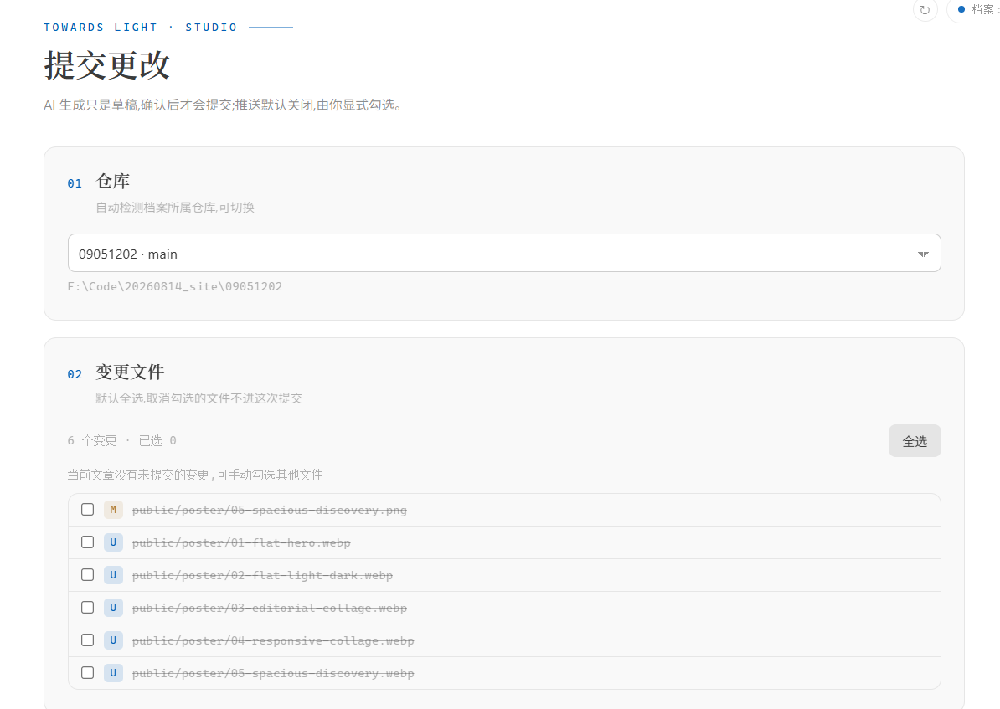

AI 生成提交信息时，只看本次勾选的文件。仓库最近提交仅作为格式样例，不能把旧文章或旧项目名借进新标题。生成结果会先写回输入框供检查，不会直接提交。

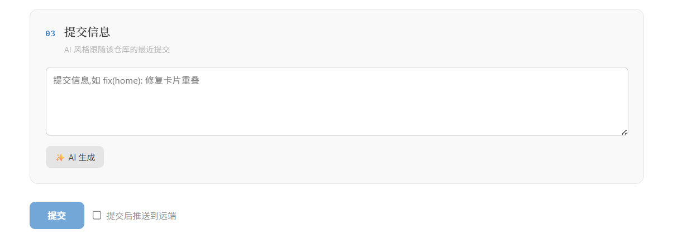

## 站点信息

站点信息写回当前档案的 `site.ts`：站点名、作者、长短签名、邮箱、站点 URL、默认主题、头像、当前状态、首页 Hero、各页面背景、归档/标签/分类/链接/404 页面标题与描述。

- 图片字段带实时缩略图。
- 「选择图片…」会把所选图片复制进档案 `images/`，并按 `/images/...` 引用。
- 写回走 AST 级就地修改，注释、格式和 `as const` 断言会保留。
- 未保存输入会在面板重建后恢复；如果文件在别处已经变化，旧草稿自动作废，以文件为准。

<table>
  <tr>
    <td width="58%">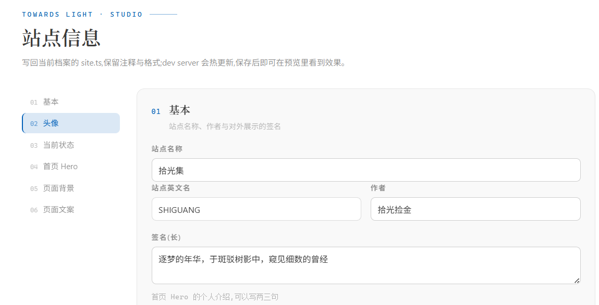</td>
    <td width="42%">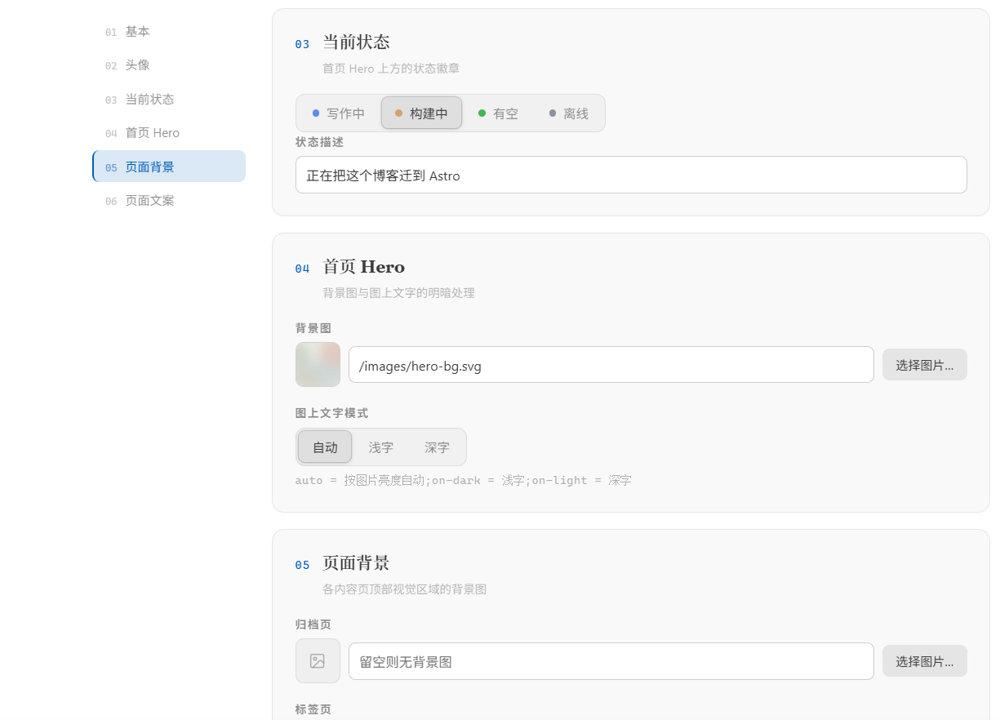</td>
  </tr>
</table>

## 分类管理

分类写进 `site.ts` 的 `categoryMeta`；文章 frontmatter 使用同名 `category` 即归入该分类。

- 支持新建、编辑图标、色调与描述。
- 分类列表会标出当前被多少篇文章引用。
- 被文章引用的分类锁定改名与删除；未被引用的分类可以改名或删除。
- 文章正在使用、但尚未登记进 `categoryMeta` 的分类也会列出，可一键补登记。

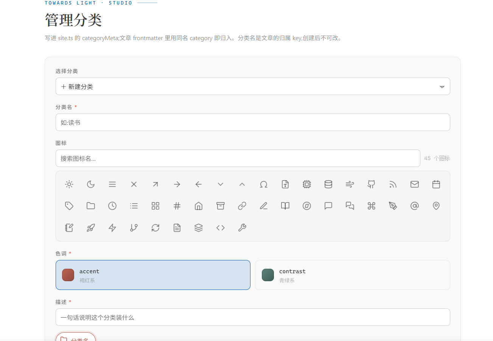

## 链接管理

链接管理写回当前档案的 `links.ts`。页面按分组组织，支持：

- 分组新建、改名、改描述与删除空分组。
- 分组头拖拽排序。
- 链接行内展开编辑，组内上下移动。
- 两段式删除，防止误点。
- 图标搜索、`featured` 大卡片、`home` 首页展示。
- 首页展示最多保留 3 条，超过会被表单拒绝。

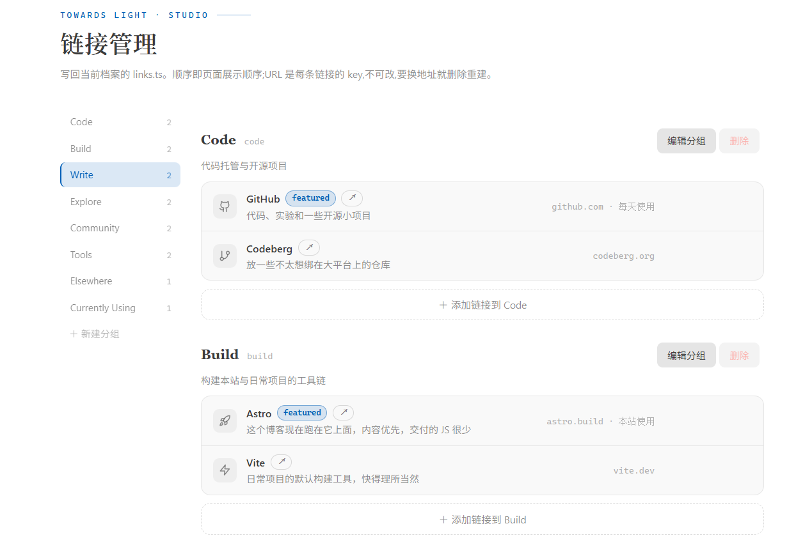

## 图标补录

输入 lucide.dev 上的图标名，插件会从 `lucide-static` 中提取 SVG，并补录进模板的 `Icon.astro`。分类与链接表单重新打开后即可选择新图标。

## AI 与设置

设置面板目前包含两类配置：

- **AI 摘要**：默认使用 VS Code 语言模型，借用 Copilot 登录态，零配置；也可切到自定义 OpenAI 兼容端点。`Base URL` 与 `model` 保存在扩展的 workspace 状态里；`API key` 单独写入 VS Code `SecretStorage`，不会落进配置文件。模型不可用或请求失败时回退到本地规则提取。
- **预览**：设置 Astro dev server 起始端口，端口占用时自动顺延。

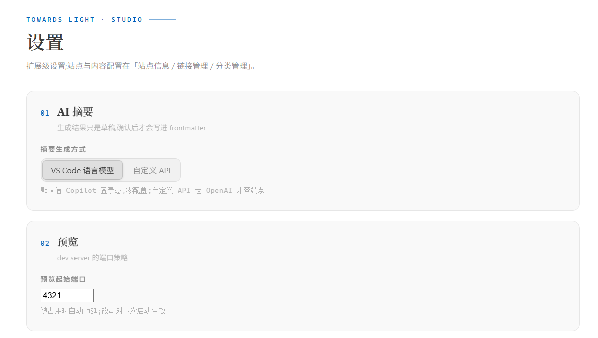

同一套 AI 配置用于文章摘要和提交信息。两类生成结果都先作为草稿展示，不会自动写入文件或自动提交。

## 图片资产约定

```text
<档案>/
├── images/                  # 站点级：头像、Hero、页面背景，按 /images/... 引用
└── posts/
    ├── my-post.md
    └── image/my-post/       # 文章级：封面与正文插图，使用相对路径引用
```

文章级提交会读取正文中的实际图片引用，兼容历史文章把图片放在短目录名里的情况；新建插图仍按 `image/<文章名>/` 归档。

## 开发

```bash
npm install
npm run build      # esbuild 产物：dist/extension.js + dist/core.mjs
npm test           # 35 项核心断言 + 3 项 Git 上下文断言
npm run package    # 产出 VSIX
```

调试时在 VS Code 中打开 `editor/` 目录按 `F5`，扩展开发宿主会加载当前插件并打开博客工程根目录。

源码结构：

```text
src/extension.ts        # 命令注册、档案切换、插图、生命周期
src/sidebar.ts          # 侧边栏控制台与当前文章属性面板
src/preview.ts          # dev server 账本、iframe 预览、junction 感知
src/git.ts              # 仓库探测、状态、diff、选择性提交与推送
src/ai.ts               # AI 提供方选择、Copilot/OpenAI/本地回退
src/core/               # 不依赖 VS Code 的文件读写、AST 修改、frontmatter、图片逻辑
src/webviews/           # 文章中心、编辑文章、提交更改、站点/分类/链接/设置面板
templates/profile/      # 新档案骨架
```

## 边界

- 这个插件管理本地文件与本地 Git，不直接发布站点。
- 不提供文章 slug 重命名，也不做定时发布。
- AI 只负责生成摘要或提交信息草稿，最终写入与提交都需要人工确认。
- 未跟踪的超大文本文件不会进入 AI 上下文；二进制文件只以路径参与。